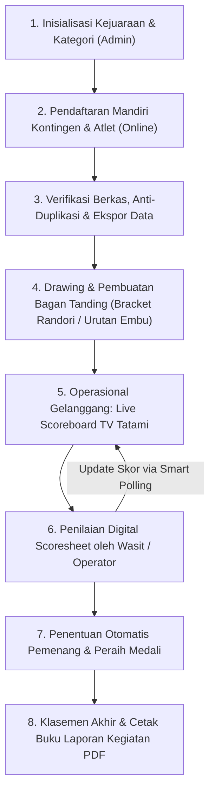

# 🥋 Sistem Informasi Manajemen Pertandingan & Kejuaraan Shorinji Kempo
### *Shorinji Kempo Tournament Management & Digital Scoring System*


Sistem Informasi Manajemen Pertandingan Shorinji Kempo adalah aplikasi berbasis web yang dirancang untuk mengotomasi dan mendigitalkan seluruh rangkaian penyelenggaraan kejuaraan olahraga Shorinji Kempo (Persaudaraan Bela Diri Kempo Indonesia / PERKEMI). 

Sistem ini mengelola siklus kejuaraan secara menyeluruh (*end-to-end*), mulai dari pendaftaran kontingen/atlet/official mandiri, pengundian dan manipulasi bagan (*tournament bracket*), penilaian digital (*digital scoresheet*) untuk nomor **Embu** dan **Randori**, papan skor tatami publik *real-time* dengan teknologi *Smart Polling*, hingga kalkulasi otomatis klasemen perolehan medali dan penerbitan buku laporan kejuaraan berformat PDF & Excel.

---

## 📑 Daftar Isi

- [Fitur Utama Sistem](#-fitur-utama-sistem)
  - [1. Dashboard Kejuaraan & Statistik](#1-dashboard-kejuaraan--statistik)
  - [2. Pendaftaran Mandiri & Manajemen Kontingen](#2-pendaftaran-mandiri--manajemen-kontingen)
  - [3. Manajemen Kategori & Nomor Tanding](#3-manajemen-kategori--nomor-tanding)
  - [4. Manajemen Bagan Pertandingan (Tournament Bracket)](#4-manajemen-bagan-pertandingan-tournament-bracket)
  - [5. Sistem Penilaian Digital (Scoresheet Multi-Babak)](#5-sistem-penilaian-digital-scoresheet-multi-babak)
  - [6. Papan Skor Tatami Real-Time (Live Scoreboard)](#6-papan-skor-tatami-real-time-live-scoreboard)
  - [7. Rekapitulasi Medali & Pelaporan Resmi](#7-rekapitulasi-medali--pelaporan-resmi)
- [Matriks Hak Akses Pengguna (Role & Otorisasi)](#-matriks-hak-akses-pengguna-role--otorisasi)
- [Alur Kerja Kejuaraan (Tournament Workflow)](#-alur-kerja-kejuaraan-tournament-workflow)
- [Teknologi & Dependensi](#-teknologi--dependensi)
- [Struktur Direktori Proyek](#-struktur-direktori-proyek)
- [Panduan Instalasi & Konfigurasi](#-panduan-instalasi--konfigurasi)
- [Akun Pengguna Default](#-akun-pengguna-default)
- [Dokumentasi Manual Pengguna (User Manuals)](#-dokumentasi-manual-pengguna-user-manuals)

---

## 🚀 Fitur Utama Sistem

### 1. Dashboard Kejuaraan & Statistik
* **Filter Dinamis Kejuaraan**: Memungkinkan pimpinan dan administrator beralih pantauan antar kegiatan/kejuaraan yang sedang berlangsung.
* **4 Kartu Ringkasan Cepat (*Stat Cards*)**: Menampilkan total atlet (kenshi), total official/pelatih, rincian perolehan medali (Emas, Perak, Perunggu), dan total nomor pertandingan.
* **Tabel Klasemen Juara Umum Kontingen**: Kalkulasi peringkat perolehan medali kontingen secara langsung berdasarkan regulasi resmi PERKEMI.

### 2. Pendaftaran Mandiri & Manajemen Kontingen
* **Tautan Publik Pendaftaran**: Formulir daring khusus untuk pendaftaran peserta (`/pendaftaran/{id}/daftar`) dan official (`/official/{id}/daftar`) tanpa harus login.
* **Filter Kategori Otomatis**: Kategori pertandingan yang muncul langsung disesuaikan dengan jenis kelamin dan rentang usia (tanggal lahir) kenshi.
* **Integrasi Wilayah Administratif**: Terhubung dengan master data wilayah (Provinsi, Kabupaten/Kota, Kecamatan, hingga Kelurahan/Desa).
* **Fitur Anti-Duplikasi & Pembersihan Data**: Validasi pencegahan ganda (*throttle check*) dan tombol operasional *"Hapus Duplikat"* peserta serta official.
* **Input Komposisi Teknik Embu**: Formulir daring pencatatan daftar teknik/jurus kenshi (`/teknik/{id}`).
* **Ekspor Data ke Microsoft Excel**: Mengunduh seluruh data pendaftar kenshi dan official per kontingen secara instan.

### 3. Manajemen Kategori & Nomor Tanding
* **Dukungan Dua Disiplin Pertandingan**:
  * **Embu (Kerapian Teknik/Jurus)**: Kategori Solo/Tandoku Embu, Pasangan/Kumi Embu, dan Beregu/Dantai Embu (Kyu Kenshi hingga Yudansha).
  * **Randori (Pertarungan Bebas)**: Pengelompokan berdasarkan kelas berat badan, gender (Putra/Putri), dan tingkatan sabuk/usia.
* **Fleksibilitas Pengaturan Kuota & Peserta**: Kemudahan menambah, memperbarui, atau mengarsipkan nomor tanding per kegiatan.

### 4. Manajemen Bagan Pertandingan (Tournament Bracket)
* **Generasi Bagan Sistem Gugur (Knockout Bracket)**: Pembuatan bagan otomatis untuk 4, 8, 16, hingga 32 peserta pada nomor Randori.
* **Fitur Interaktif Edit Bagan Manual**:
  * **Swap Bagan**: Menukar posisi atlet antar slot bagan secara langsung tanpa merusak struktur partaian.
  * **Direct Assign**: Mengisi atau memindahkan atlet ke slot kosong tertentu secara fleksibel.
* **Audit Trail (Log Perubahan Bagan)**: Setiap perubahan posisi atlet terekam detail pada tabel `LogPerubahanBagan` (waktu, admin pelaksana, posisi asal, dan posisi tujuan) untuk menjamin transparansi.

### 5. Sistem Penilaian Digital (Scoresheet Multi-Babak)
* **Penilaian Embu (Scoresheet Embu)**:
  * Form penilaian multi-juri (Wasit 1 s/d Wasit 5).
  * Perhitungan nilai akhir otomatis mengikuti regulasi standar Kempo: eliminasi nilai tertinggi dan terendah, lalu akumulasi nilai tengah.
  * Input pengurangan nilai / penalti waktu / pelanggaran teknis.
  * Perankingan otomatis nilai peserta per babak (Babak Penyisihan, Babak Final).
* **Penilaian Randori (Duel Scoresheet Randori)**:
  * Form duel Sudut Merah (*Aka*) vs Sudut Putih (*Shiro*).
  * Pencatatan poin serang: *Waza-ari* dan *Ippon*.
  * Pencatatan teguran & hukuman: *Shido*, *Chui*, dan *Hansoku*.
  * Penentuan pemenang otomatis dan sinkronisasi ke bagan babak berikutnya (Penyisihan, Perempat Final, Semifinal, Final, serta perebutan Juara 3 Bersama).
* **Multi-Round Support**: Menyimpan riwayat penilaian terpisah antar babak secara rapi.

### 6. Papan Skor Tatami Real-Time (Live Scoreboard)
* **Akses Publik Tanpa Login**: Halaman layar gelanggang (`/kegiatan/{id}/papan-skor`) siap diproyeksikan ke monitor TV tatami atau proyektor arena.
* **Smart Polling (Zero Flicker & Low Bandwidth)**: Pembaruan skor dan medali otomatis menggunakan verifikasi checksum hash MD5; DOM diperbarui hanya saat terjadi perubahan data tanpa *reload* halaman.
* **Stopwatch / Timer Terintegrasi**: Pengatur waktu ronde dan jeda istirahat dengan tombol Start, Pause, Reset, serta efek audio buzzer/bel.
* **Tampilan Adaptif**: Menyesuaikan tampilan secara otomatis antara format duel Sudut Merah vs Putih (Randori) dan format tabel urutan tampil serta nilai wasit (Embu).

### 7. Rekapitulasi Medali & Pelaporan Resmi
* **Halaman Laporan Kegiatan**: Rekapitulasi klasemen medali kontingen dan daftar juara per kategori pertandingan.
* **Cetak Buku Laporan Resmi (PDF)**: Dokumen siap cetak berstandar laporan pertanggungjawaban untuk pimpinan PERKEMI, KONI, dan Dinas Pemuda & Olahraga (Dispora).
* **Cetak Lembar Scoresheet**: Format cetak penilaian wasit untuk Embu dan Randori.
* **Cetak Bagan Pertandingan & ID Card Kontingen**: Dokumen visual bagan turnamen dan kartu pendaftaran kontingen.

---

## 👥 Matriks Hak Akses Pengguna (Role & Otorisasi)

Aplikasi menerapkan kontrol otorisasi berbasis peran:

| Modul / Menu | Administrator (`admin`) | Wasit / Juri (`wasit`) | Kontingen / Atlet (`user`) | Tamu / Publik (Tanpa Login) |
| :--- | :---: | :---: | :---: | :---: |
| **Login & Autentikasi** | ✅ | ✅ | ✅ | ❌ |
| **Dashboard Ringkasan** | ✅ | ❌ *(Redirect ke Kegiatan)* | ✅ *(Data Kontingen)* | ❌ |
| **Manajemen Pengguna (`/users`)** | ✅ | ❌ *(Dibatasi)* | ❌ *(Dibatasi)* | ❌ |
| **Master Kategori & Tanding** | ✅ | ❌ *(Dibatasi)* | ❌ *(Read-only)* | ❌ |
| **Manajemen Kegiatan Kejuaraan** | ✅ | ✅ *(Akses Tatami)* | ❌ *(Read-only)* | ❌ |
| **Pendaftaran Mandiri Atlet/Official** | ✅ | ❌ | ✅ | ✅ *(Via Link Publik)* |
| **Ekspor Data Excel & Hapus Duplikat** | ✅ | ❌ | ❌ | ❌ |
| **Kelola Bagan (Swap / Assign)** | ✅ | ✅ | ❌ | ❌ |
| **Input Nilai Digital (Scoresheet)** | ✅ | ✅ | ❌ | ❌ |
| **Live Papan Skor Tatami** | ✅ | ✅ | ✅ | ✅ *(Akses Publik)* |
| **Cetak PDF Laporan & Bagan** | ✅ | ✅ *(Bagan/Scoresheet)* | ❌ | ❌ |

---

## 🔄 Alur Kerja Kejuaraan (Tournament Workflow)



---

## 🛠 Teknologi & Dependensi

* **Backend**: [Laravel 12](https://laravel.com/) (PHP ^8.2)
* **Frontend**: [Tailwind CSS v4](https://tailwindcss.com/), [Argon Dashboard UI](https://www.creative-tim.com/), [Vite 6](https://vitejs.dev/)
* **Database**: MySQL 8.0+ / MariaDB (Mendukung SQLite untuk pengujian)
* **Ikonografi & Font**: Font Awesome 6, Google Fonts (*Inter* & *Plus Jakarta Sans*)
* **Komponen Tambahan**:
  * [Select2](https://select2.org/) - Komponen dropdown pencarian interaktif
  * [barryvdh/laravel-dompdf](https://github.com/barryvdh/laravel-dompdf) - Generator dokumen PDF resmi
  * [maatwebsite/excel](https://github.com/SpartnerNL/Laravel-Excel) - Impor & ekspor lembar kerja Excel
  * [intervention/image](https://image.intervention.io/) - Manipulasi foto dan logo

---

## 📁 Struktur Direktori Proyek

```plaintext
kempo/
├── app/
│   ├── Http/Controllers/
│   │   ├── HomePageController.php      # Autentikasi, pendaftaran publik, dashboard, teknik
│   │   ├── PertandinganController.php  # Bagan, scoresheet duel, laporan kegiatan, smart polling
│   │   ├── PesertaController.php       # Manajemen data kenshi, filter, ekspor Excel
│   │   ├── OfficialController.php      # Manajemen pelatih & official kontingen
│   │   ├── KegiatanController.php      # Kelola event/kejuaraan kempo
│   │   ├── KategoriController.php      # Master kelas tanding Embu & Randori
│   │   ├── KontigenController.php      # Rekapitulasi berkas & perwakilan daerah
│   │   └── UsersController.php         # Manajemen akun pengguna & hak akses
│   └── Models/
│       ├── Pertandingan.php            # Model partai/nomor tanding
│       ├── PertandinganPeserta.php     # Detail skor, babak, medali kenshi
│       ├── Peserta.php                 # Biodata kenshi & kontingen
│       ├── PesertaTerpilih.php         # Penempatan bagan & kenshi tanding
│       ├── LogPerubahanBagan.php       # Catatan histori swap/edit bagan
│       ├── Kegiatan.php                # Master data kejuaraan
│       └── User.php                    # Akun pengguna sistem
├── database/
│   ├── migrations/                     # Skema tabel database sistem
│   └── seeders/                        # Data awal & user administrator
├── md/
│   ├── manual/                         # Buku Panduan Operasional Lengkap (Admin, Wasit, Embu, Randori)
│   ├── catatan/                        # Skema database & log perbaikan sistem
│   └── revisi/                         # Panduan teknis update fitur & smart polling
├── resources/
│   ├── views/
│   │   ├── admin/                      # Tampilan antarmuka panel administrasi
│   │   │   └── pertandingan/           # Modal scoresheet, bagan, laporan PDF
│   │   ├── pages/                      # Papan skor publik tatami
│   │   ├── pengunjung/                 # Formulir pendaftaran online publik
│   │   └── tamplate.blade.php          # Tata letak utama (Layout & Sidebar)
│   └── css/ & js/                      # Aset Tailwind CSS v4 & JavaScript Vite
└── routes/
    └── web.php                         # Definisi seluruh rute sistem
```

---

## 💻 Panduan Instalasi & Konfigurasi

### 1. Kebutuhan Sistem
Pastikan perangkat kerja telah terpasang:
* **PHP** versi 8.2 atau lebih baru
* **Composer** versi 2.x
* **Node.js** (v18+) & **NPM**
* **MySQL** Server (melalui Laragon, XAMPP, atau instalasi native)

### 2. Kloning & Persiapan Proyek
Buka terminal dan arahkan ke direktori server web lokal Anda (misal `c:\laragon\www\`):
```bash
cd c:\laragon\www\kempo
```

### 3. Instalasi Dependensi PHP & Node
```bash
composer install
npm install
```

### 4. Konfigurasi Environment (`.env`)
Salin file konfigurasi contoh dan buat application key baru:
```bash
cp .env.example .env
php artisan key:generate
```

Sesuaikan konfigurasi koneksi database pada file `.env`:
```env
DB_CONNECTION=mysql
DB_HOST=127.0.0.1
DB_PORT=3306
DB_DATABASE=aplikasiposinfo_daftar_kempo
DB_USERNAME=root
DB_PASSWORD=
```

### 5. Migrasi & Seeder Database
Jalankan migrasi skema tabel dan data awal sistem:
```bash
php artisan migrate --seed
```

### 6. Kompilasi Aset Frontend
Untuk mode pengembangan (*development*):
```bash
npm run dev
```
Atau untuk build produksi:
```bash
npm run build
```

### 7. Menjalankan Server Aplikasi
Jika menggunakan Laragon, aplikasi dapat langsung diakses melalui virtual host `http://kempo.test`. Alternatif menggunakan artisan:
```bash
php artisan serve
```
Akses aplikasi melalui browser: `http://127.0.0.1:8000`.

---

## 🔑 Akun Pengguna Default

Setelah proses seeder selesai dijalankan, Anda dapat masuk ke dalam sistem menggunakan akun Administrator berikut:

* **Email:** `admin@email.com`
* **Password:** `123456`
* **Role:** `admin`

> Akun Wasit dan Operator Kontingen dapat ditambahkan secara fleksibel melalui Menu **Master Data > Pengguna** di dalam aplikasi.

---

## 📖 Dokumentasi Manual Pengguna (User Manuals)

Panduan operasional langkah demi langkah yang ramah bagi pengguna awam, panitia, dan pimpinan tersedia secara lengkap pada direktori `md/manual/`:

* 📘 [Panduan Operasional Administrator Pusat (`md/manual/admin.md`)](md/manual/admin.md)
* 📊 [Panduan Operasional Halaman Utama Dashboard (`md/manual/dashboard.md`)](md/manual/dashboard.md)
* 🥋 [Panduan Lengkap Penilaian & Operasional Kategori Embu (`md/manual/embu.md`)](md/manual/embu.md)
* 🥊 [Panduan Lengkap Penilaian, Bagan & Duel Randori (`md/manual/randori.md`)](md/manual/randori.md)
* 📺 [Panduan Pengoperasian Layar Papan Skor Gelanggang (`md/manual/papan-skor.md`)](md/manual/papan-skor.md)
* 📝 [Panduan Alur Pendaftaran Peserta & Official Kontingen (`md/manual/fitur-pendaftaran.md`)](md/manual/fitur-pendaftaran.md)
* ⚖️ [Panduan Peran & Tugas Khusus Operator Wasit (`md/manual/peran_dan_tugas_operator_wasit.md`)](md/manual/peran_dan_tugas_operator_wasit.md)

---

## 📄 Lisensi
Sistem Informasi Pertandingan Shorinji Kempo dikembangkan di bawah lisensi resmi [MIT License](LICENSE).
